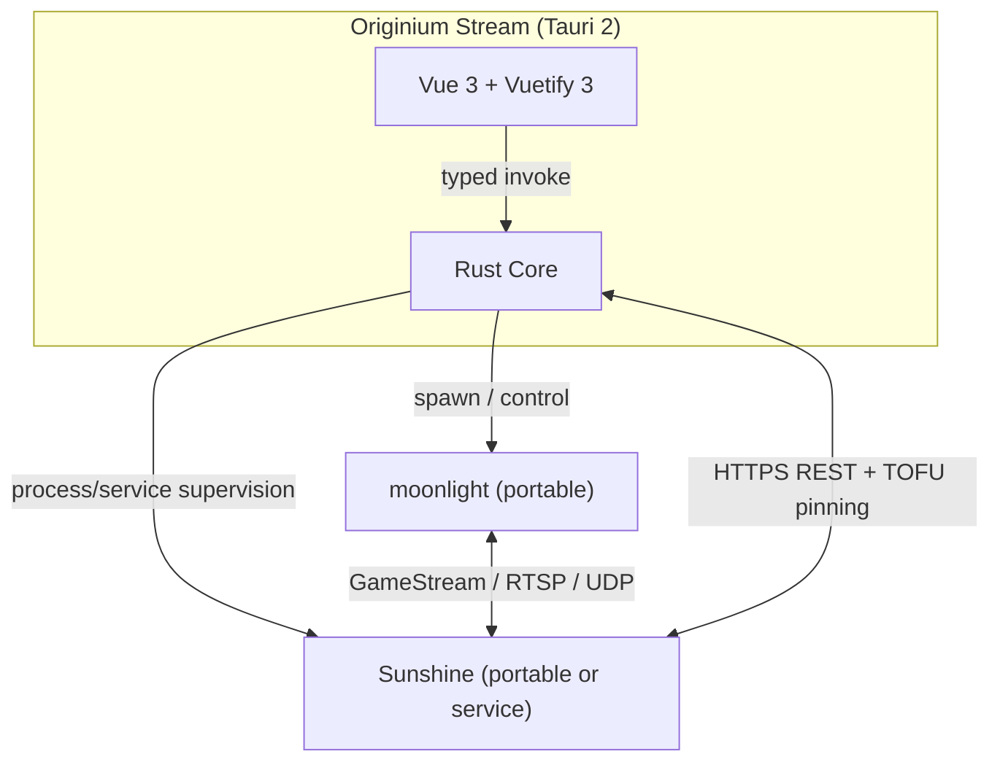

# Originium Stream

> One application to host **and** to stream. Sunshine and Moonlight under a single WebUI.

[](https://github.com/robinmaomao/originium-stream-webui/actions/workflows/app-ci.yml)
[](https://github.com/robinmaomao/originium-stream-webui/releases/latest)
[](./LICENSE)

## Download

- [Installer (NSIS) & MSI](https://github.com/robinmaomao/originium-stream-webui/releases/latest)
- [Portable ZIP](https://github.com/robinmaomao/originium-stream-webui/releases/latest) — extract and run `Originium Stream.exe`

Originium Stream is a Windows desktop application that unifies:

- **Sunshine** — the open-source game stream host, managed as a background service or child process.
- **Moonlight** — the open-source game stream client, launched as a portable child process only while streaming.

Open the app and your machine is simultaneously:

1. **Discoverable and streamable** — Sunshine advertises `_nvstream._tcp` over mDNS and accepts standard Moonlight clients.
2. **A client** — the app browses the LAN for other Sunshine hosts, pairs automatically, and starts streams with one click.

All Sunshine and Moonlight settings live in the same UI, including a fully customizable theme system (fonts, background images, color tokens, presets, import/export).

## Features

- **Dual-stack runtime** — local Sunshine service/process supervision plus on-demand Moonlight sessions, both from one window.
- **Display-aware shell** — the window fits the current monitor work area across Windows DPI scales, with a responsive icon rail on narrow screens and hidden scrollbars that preserve wheel/touch scrolling.
- **Startup service** — optionally starts the Sunshine service when the app launches; Moonlight remains on-demand and no resident Moonlight process is created.
- **Component manager** — portable Sunshine and Moonlight bundles are downloaded, SHA-256 verified, extracted, versioned and rolled back automatically. Local overrides are supported for development.
- **LAN discovery & automated pairing** — `mdns-sd` browse + `moonlight pair --pin` + Sunshine `/api/pin` approval, no manual PIN typing on the client.
- **Complete settings coverage**
  - Sunshine: dynamic forms for every `/api/config` key (audio, video, network, input, applications, clients, advanced, troubleshooting).
  - Moonlight: full portable INI read/write plus a typed stream profile mapped to CLI flags.
- **Theme engine** — color tokens, typography (custom Woff2/TTF/OTF), background images (opacity/blur/fill), dark/light presets, JSON import/export, reduced-motion and contrast-aware.
- **Fused title bar** — draggable custom title bar with window controls, integrated session/theme actions, and optional native acrylic translucency with a CSS fallback.
- **Session HUD** — always-on-top compact overlay, global hotkey (`CommandOrControl+Alt+Shift+O`).
- **Observability** — structured logs, host logs, diagnostics bundle export, no telemetry.

## Architecture



See [docs/architecture.md](./docs/architecture.md) for details.

## Getting started

### Prerequisites

| Tool | Version |
|---|---|
| Windows | 10 1809+ / 11 (WebView2 runtime required) |
| Node.js | 24+ |
| pnpm | 10+ |
| Rust | 1.100+ (`stable-x86_64-pc-windows-msvc`) |
| Visual Studio Build Tools | 2022 (MSVC + Windows SDK) |

### Development

```powershell
pnpm install
pnpm tauri dev
```

### Tests & checks

```powershell
pnpm --filter @originium/desktop typecheck
pnpm --filter @originium/desktop test
pnpm --filter @originium/desktop lint
pnpm build
cargo test --manifest-path apps/desktop/src-tauri/Cargo.toml
cargo clippy --manifest-path apps/desktop/src-tauri/Cargo.toml -- -D warnings
```

### Packaging

```powershell
pnpm tauri build
```

Artifacts (NSIS + MSI) are written under `apps/desktop/src-tauri/target/release/bundle/`.

## Repository layout

```
.
├─ apps/desktop/            # Tauri 2 + Vue 3 application
│  ├─ src/                  # Vue UI, stores, API bindings, locales, theme
│  └─ src-tauri/            # Rust core, commands, Sunshine/Moonlight integration
├─ packages/shared/         # Shared TypeScript types (reserved)
├─ docs/                    # Architecture, decisions, build, theming, security
├─ components.lock.json     # Pinned component versions / SHA-256 / capabilities
├─ scripts/                 # Developer utilities (icons, release helpers)
└─ third_party_licenses/    # Attribution for bundled GPL components
```

## Components

Components are described by [`components.lock.json`](./components.lock.json):

```json
{
  "id": "moonlight",
  "variant": "originium",
  "version": "6.2.0-org.1",
  "url": "https://github.com/robinmaomao/originium-moonlight/releases/download/v6.2.0-org.1/MoonlightPortable-x64-6.2.0.zip",
  "sha256": "8872b268b3d29eae0d6c4ecddb56cf0485dc2be3802d57a782c6f06c8e11be78",
  "entry": "Moonlight.exe",
  "capabilities": ["control-pipe"]
}
```

Capabilities let the app degrade gracefully when an official upstream build is used instead of a fork build. See [docs/components.md](./docs/components.md).

## Relationship with upstream projects

- [Sunshine](https://github.com/SunshineStream/Sunshine) and [moonlight-qt](https://github.com/moonlight-stream/moonlight-qt) are **GPL-3.0**.
- Originium Stream **does not modify or push to upstream repositories**. Patches live on the `originium` branches of [originium-sunshine](https://github.com/robinmaomao/originium-sunshine) and [originium-moonlight](https://github.com/robinmaomao/originium-moonlight); both forks track upstream history for rebases.
- Bundled binaries must be accompanied by their license texts and source availability (see [third_party_licenses](./third_party_licenses/README.md)).

## License

Copyright © 2026 Originium Stream contributors.

Licensed under the GNU General Public License v3.0 or later. See [LICENSE](./LICENSE).
