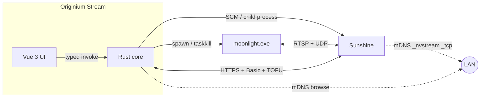
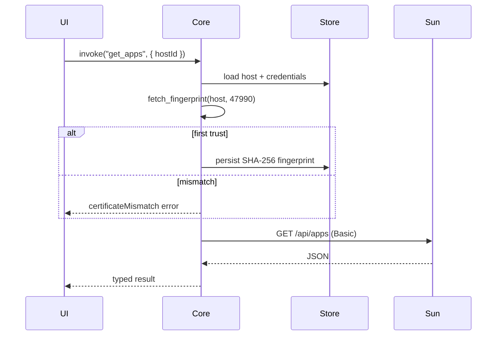

# Architecture

## Goals

1. **One app, two roles.** Opening Originium Stream on any machine simultaneously provides Sunshine host capability and Moonlight client capability.
2. **No manual app launches.** Sunshine runs as a Windows service (or supervised child process); Moonlight is spawned per session and destroyed on exit.
3. **Complete settings parity.** Every Sunshine option and every Moonlight preference is reachable from one UI.
4. **Degrade gracefully.** Official upstream binaries remain supported; fork-only capabilities are negotiated via a capability manifest.

## Runtime model



- **Control plane** — Tauri IPC from Vue to Rust; Rust owns all network and process access.
- **Host data plane** — Sunshine handles mDNS advertisement, pairing, RTSP and UDP media.
- **Client data plane** — moonlight-qt handles the GameStream session.

## Module map

| Module | Responsibility |
|---|---|
| `store.rs` | Atomic JSON config, theme, assets, credentials (Windows Credential Manager), manifest loading |
| `sunshine.rs` | HTTPS client, Basic auth, TOFU fingerprint capture (rustls), API surface, status mapping |
| `components.rs` | Manifest validation, download, SHA-256, safe ZIP extraction, installation, binary location, service management, environment detection |
| `moonlight.rs` | Portable INI parse/serialize, stream profile → CLI args, session lifecycle, log tail |
| `discovery.rs` | `mdns-sd` browse for `_nvstream._tcp` |
| `state.rs` | Global state: config, session, per-host client factory |
| `commands/*` | Tauri commands grouped by domain |
| `logging.rs` | In-memory ring buffer + rotating file log |
| `theme` (frontend) | CSS variables, font registration, Vuetify theme sync |

Sunshine advertises its GameStream HTTP port (default `47989`) over
`_nvstream._tcp`. The HTTPS configuration API lives one port higher (`47990` by
default), so `discovery.rs` maps the advertised port to the API port and
`state.rs` migrates older mDNS entries that were saved with the GameStream port.

## Request lifecycle



## Session lifecycle

1. `launch_session` validates host and profile.
2. `moonlight.exe stream <host> "<app>" --resolution …` is spawned with `CREATE_NO_WINDOW`.
3. stdout/stderr are streamed into the log buffer and session snapshot.
4. Stop: `taskkill /PID <pid> /T /F`, then `moonlight quit <host>` as a best-effort remote cleanup.
5. HUD window (always-on-top, transparent) can be toggled via global hotkey.

## Data directory

```
%APPDATA%/dev.originium.stream/
├─ config.json          # AppConfig (hosts, settings, theme, onboarding)
├─ theme.json           # Theme snapshot
├─ components/          # Installed portable components
├─ fonts/               # Imported fonts
├─ backgrounds/         # Imported background images
├─ logs/originium.log   # Rotating application log
└─ diagnostics-*.zip    # Exported diagnostics bundles
```

## Trust boundaries

- Webview ↔ Rust: typed commands, minimal capability set, no arbitrary shell.
- Rust ↔ Sunshine: HTTPS with TOFU pinning; credentials never leave the OS keychain.
- Rust ↔ components: SHA-256 verified archives, path-traversal-safe extraction, local overrides are explicit.
